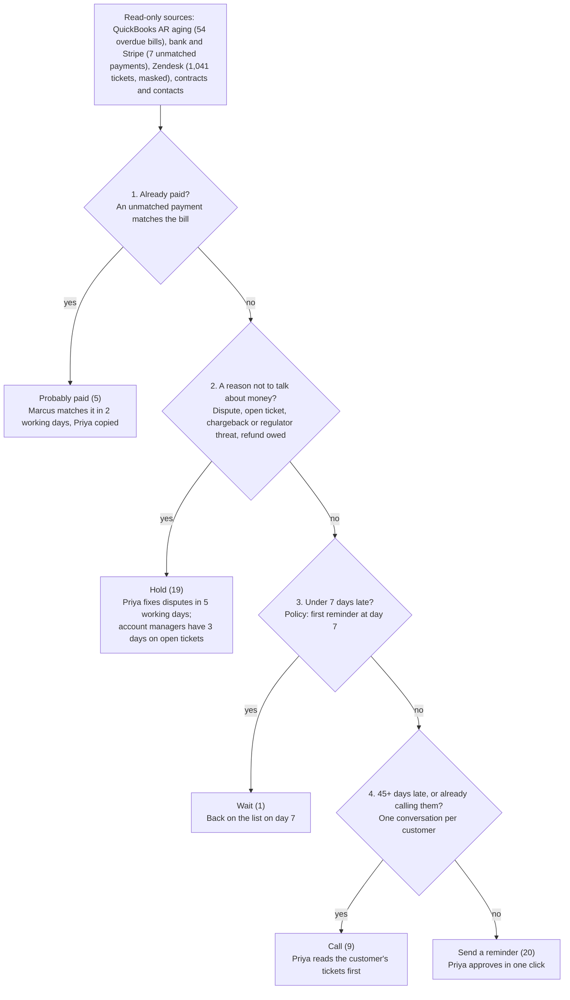

# The process: Ledgerline collections (FIN-1)

**One process:** "Should we chase this invoice today?" Ledgerline's FIN-1 Collections, owned by Priya Nair (AR Specialist). It touches two neighbouring processes only where collections needs them: FIN-2 cash application (Marcus Bell matches payments) and FIN-6 billing errors (disputed bills are corrected before anyone asks for money).

The same diagram is live in the app on the "How it works" page, with today's counts.

## Every morning, for each overdue bill

**Always a person:** top-50 accounts, disputed or probably-paid bills, anything firmer than a friendly nudge, and every phone call. Nothing is sent without a person.

## Ledgerline's FIN-1 today vs with the tool

| Step today (processes.md) | With the tool |
|---|---|
| 1. Export the AR aging report from QuickBooks | Read-only connection; export upload as the fallback |
| 2. Check each overdue account for a dispute or escalation by asking around | Reads tickets: 14 disputed bills found; account managers get one Slack DM a day (3 to 4 of the team's 16 hours a week, COO's estimate) |
| 3. Write reminder emails by hand from saved templates | Drafts from Ledgerline's own templates, without the 45-day suspension threat; approve all in one click |
| 4. Phone the largest overdue accounts | Call list, with "read before you call" tickets beside each call |
| 5. Agree payment plans | Not built: plans need the VP Finance's approval. Next step |
| 6. Escalate stuck accounts to the VP Finance | 90-day escalation, warnings before automatic write-offs, corrections over $2,500 |

| FIN-1 pain (processes.md) | Answer |
|---|---|
| Reminders go out late and inconsistently | One morning list, rebuilt from the data every day |
| Customers with an open complaint get chased | Holds: disputes, open tickets, threats. "Complaint open but chased": 0 |
| Failed card payments are rarely followed up | Priya owns them; Dana is warned before automatic write-offs |
